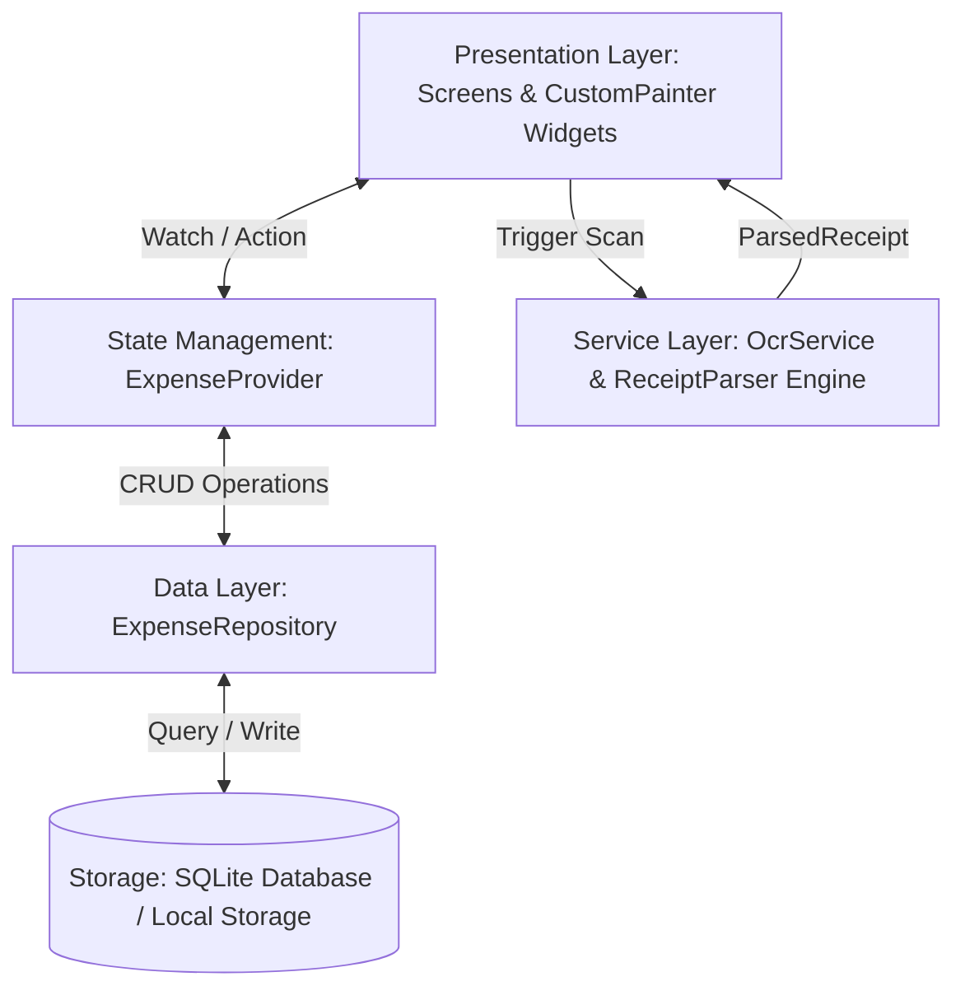

# 📱 OCR Expense Tracker & Receipt Parser (Mini-Project 3)

> **Hệ thống Quản lý Chi tiêu Cá nhân & Quét Hóa đơn Thông minh bằng On-Device AI**  
> Dự án môn học: **Lập trình Ứng dụng Di động (Flutter & Dart)** — Học kỳ VKU  
> Sinh viên thực hiện: **Trần Thanh Phong** | MSSV: **23IT211** | Lớp: **23JIT**

[](https://flutter.dev)
[](https://dart.dev)
[](https://developers.google.com/ml-kit)
[](https://pub.dev/packages/sqflite)
[](https://rynnne3125.github.io/expense_tracker_ocr/)
[](LICENSE)

---

## 👨‍🎓 Thông Tin Sinh Viên & Dự Án

* **Họ và tên:** Trần Thanh Phong
* **Mã số sinh viên (MSSV):** 23IT211
* **Lớp:** 23JIT
* **Trường:** Trường Đại học Công nghệ Thông tin & Truyền thông Việt - Hàn (VKU), Đại học Đà Nẵng
* **Email:** [phongtt.23it@vku.udn.vn](mailto:phongtt.23it@vku.udn.vn)
* **GitHub Profile:** [@Rynnne3125](https://github.com/Rynnne3125)
* **Kho lưu trữ (Repository):** [https://github.com/Rynnne3125/expense_tracker_ocr](https://github.com/Rynnne3125/expense_tracker_ocr)
* **Live Demo (GitHub Pages):** [https://rynnne3125.github.io/expense_tracker_ocr/](https://rynnne3125.github.io/expense_tracker_ocr/)

---

## 🎯 Bối Cảnh Thực Tế & Đặt Vấn Đề (Problem Scenario)

Sinh viên và thủ quỹ các câu lạc bộ (CLB) sinh viên thường xuyên phải xử lý một lượng lớn hóa đơn giấy từ các hoạt động hàng ngày:
* Đi chợ, siêu thị mua thực phẩm nấu ăn (`WinMart+`, `Bách Hóa Xanh`, `Co.opmart`).
* Họp nhóm câu lạc bộ tại quán cà phê (`Highlands Coffee`, `The Coffee House`, `Phúc Long`).
* Mua giáo trình, sách vở, tài liệu photocopy tại trường (`Nhà Sách Fahasa`, `Tiền Phong`, `Photo VKU`).
* Đổ xăng xe máy đi học (`Petrolimex`, `PVOIL`).
* Mua sắm linh kiện, phụ kiện công nghệ (`Phong Vũ`, `FPT Shop`, `Thế Giới Di Động`).

**Khó khăn gặp phải:** Việc nhập tay từng con số vào bảng tính Excel/Google Sheets rất tốn thời gian, nhàm chán và cực kỳ dễ gõ sai số tiền hoặc ngày tháng.

**Giải pháp của ứng dụng:**
Cung cấp một ứng dụng di động Flutter tích hợp **Google ML Kit Text Recognition** chạy hoàn toàn **offline on-device (sub-100ms, không tốn chi phí máy chủ đám mây, bảo mật dữ liệu riêng tư)**, kết hợp cùng **Bộ phân tích cú pháp Heuristic Regex thông minh** để tự động nhận diện:
1. **Tổng số tiền thanh toán (Total Amount)** chuẩn định dạng tiền tệ Việt Nam (VND, đ).
2. **Ngày tháng giao dịch (Date)** (DD/MM/YYYY).
3. **Tên đơn vị bán lẻ / Cửa hàng (Merchant)**.
4. **Tự động phân loại danh mục (Category Auto-Classification):** Ăn uống (Food), Học tập (Study), Đi lại (Travel), Thiết bị (Gear), Giải trí (Entertainment).
5. **Trực quan hóa chi tiêu bằng Canvas thuần (`CustomPainter`):** Biểu đồ tròn Donut động tương tác và Biểu đồ cột chi tiêu theo tuần mà **không sử dụng bất kỳ thư viện biểu đồ bên thứ 3 nào**!

---

## 📋 Bảng Đối Chiếu Tính Năng (Feature Checklist)

| STT | Yêu cầu kỹ thuật | Hiện trạng đáp ứng | Chi tiết triển khai |
|:---:|:---|:---:|:---|
| 1 | **Camera Capture & Image Cropping** | ✅ Hoàn thành 100% | Khung ngắm tùy chỉnh `CropViewfinderOverlay`, hỗ trợ bật/tắt Flash, chạm lấy nét (Tap to Focus) với vòng ngắm hoạt họa, tia laser quét chuyển động, chọn ảnh từ Camera/Gallery/Mẫu có sẵn. |
| 2 | **On-Device Text Recognition** | ✅ Hoàn thành 100% | Tích hợp `google_mlkit_text_recognition` nhận diện văn bản offline trên thiết bị (< 100ms latency, zero cloud cost). Cung cấp cơ chế trừu tượng hóa cho Web/Desktop. |
| 3 | **Regex Heuristic Parser Engine** | ✅ Hoàn thành 100% | Bóc tách chính xác: Tổng tiền (154.000 VND, 118.000 đ,...), Ngày (DD/MM/YYYY), Tên cửa hàng (WinMart, Highlands, Fahasa, Petrolimex, Phong Vũ...) và lọc thông minh tránh nhầm lẫn mã hóa đơn/số điện thoại/năm. Đạt 5/5 Unit Tests. |
| 4 | **Interactive Review Screen** | ✅ Hoàn thành 100% | Màn hình `ReviewReceiptScreen` cho phép kiểm tra độ tin cậy (Confidence Score), xem văn bản OCR gốc, chọn nhanh các số tiền ứng viên và chỉnh sửa thủ công trước khi lưu. |
| 5 | **Local Database Persistence** | ✅ Hoàn thành 100% | Sử dụng SQLite (`sqflite`) trên Mobile/Desktop với bảng `expenses`, hỗ trợ `SharedPreferences` đồng bộ trên Web. Đầy đủ thao tác CRUD, tìm kiếm, lọc danh mục và seed dữ liệu mẫu sinh viên. |
| 6 | **Animated Donut Chart (CustomPainter)** | ✅ Hoàn thành 100% | Vẽ trực tiếp trên Canvas với `Canvas.drawArc`, hiệu ứng bung góc quét `CurvedAnimation`, vòng tròn tâm hiển thị tổng số tiền, chạm tương tác (Touch Detection qua `math.atan2`) để phóng to từng lát cắt. |
| 7 | **Animated Weekly Bar Chart (CustomPainter)**| ✅ Hoàn thành 100% | Vẽ bằng `Canvas.drawRRect` và `Canvas.drawLine` hiển thị 7 ngày trong tuần (T2 - CN), đường lưới ngang Y-axis, cột ngày hôm nay được làm nổi bật, tooltip tương tác chạm xem số tiền từng ngày. |
| 8 | **GitHub Pages Deployment & CI/CD** | ✅ Hoàn thành 100% | Tích hợp GitHub Actions `.github/workflows/deploy.yml` tự động build và deploy bản Web lên GitHub Pages khi push code. |

---

## 🏗️ Kiến Trúc Hệ Thống (Architecture & Design Pattern)

Dự án tuân thủ nguyên tắc **Clean Architecture** và mô hình **Repository Pattern + Provider State Management**:



### Cấu Trúc Thư Mục Dự Án:
```
lib/
├── main.dart                          # Điểm khởi chạy ứng dụng, cấu hình Theme M3 & Provider
├── models/
│   ├── expense.dart                   # Thực thể giao dịch chi tiêu (ID, Title, Merchant, Amount, Date...)
│   ├── expense_category.dart          # Phân loại danh mục (Food, Study, Travel, Gear, Entertainment)
│   └── parsed_receipt.dart            # Kết quả bóc tách từ OCR (Merchant, Total, Date, LineItems...)
├── services/
│   ├── ocr_service.dart               # Service điều phối OCR chung
│   ├── ocr_service_interface.dart     # Interface trừu tượng hóa cho dịch vụ OCR
│   ├── ocr_service_native.dart        # Triển khai OCR Native với Google ML Kit Text Recognition
│   ├── ocr_service_web.dart           # Triển khai OCR cho môi trường Web
│   ├── receipt_parser.dart            # BỘ PHÂN TÍCH CÚ PHÁP HEURISTIC REGEX NÒNG CỐT
│   └── sample_receipts_data.dart      # Dữ liệu hóa đơn mẫu thực tế (WinMart, Highlands, Fahasa, Petrolimex...)
├── repositories/
│   └── expense_repository.dart        # Lưu trữ SQLite (sqflite) trên Mobile + fallback Web
├── providers/
│   └── expense_provider.dart          # Quản lý trạng thái, tính toán thống kê và biểu đồ tuần
├── widgets/
│   ├── charts/
│   │   ├── animated_donut_chart.dart  # Biểu đồ tròn Donut vẽ hoàn toàn bằng CustomPainter
│   │   └── animated_bar_chart.dart    # Biểu đồ cột tuần vẽ hoàn toàn bằng CustomPainter
│   ├── camera/
│   │   └── crop_viewfinder_overlay.dart # Khung ngắm chụp hóa đơn với hiệu ứng laser và lấy nét
│   ├── category_chip.dart             # Chip hiển thị danh mục
│   └── expense_card.dart              # Thẻ hiển thị giao dịch kèm nhãn OCR
└── screens/
    ├── home_dashboard_screen.dart     # Màn hình chính: Thẻ số dư, Biểu đồ Canvas, Bộ lọc & Lịch sử
    ├── scanner_screen.dart            # Màn hình quét hóa đơn (Camera / Thư viện / Bộ mẫu có sẵn)
    ├── review_receipt_screen.dart     # Màn hình kiểm tra & chỉnh sửa thông tin hóa đơn sau khi OCR
    ├── transaction_detail_screen.dart # Xem chi tiết giao dịch, ảnh hóa đơn đính kèm & văn bản OCR gốc
    ├── add_edit_expense_screen.dart   # Thêm mới hoặc chỉnh sửa giao dịch thủ công
    ├── analytics_screen.dart          # Báo cáo thống kê chuyên sâu & cơ cấu tài chính
    └── student_info_dialog.dart       # Hộp thoại thông tin sinh viên thực hiện (Trần Thanh Phong - 23IT211)
```

---

## 🧠 Giải Thuật Heuristic Regex Engine Bóc Tách Hóa Đơn

Hệ thống bóc tách hóa đơn trong `ReceiptParser` hoạt động theo thuật toán 4 giai đoạn độc quyền:

### 1. Trích xuất Tổng tiền (Total Amount)
* Nhận diện các cụm từ khóa ưu tiên cấp 1 (Primary Keywords): `TỔNG CỘNG`, `TỔNG TIỀN`, `KHÁCH PHẢI TRẢ`, `TỔNG THANH TOÁN`, `CỘNG TIỀN HÀNG`, `TOTAL DUE`, `GRAND TOTAL`.
* Bắt chuỗi tiền tệ theo biểu thức chính quy:
  ```dart
  RegExp(r'(?:(?:\b|\s))(\d{1,3}(?:[.,\s]\d{3})+(?:[.,]\d+)?|\d{4,9})(?:\s*(?:đ|vnd|vnđ))?')
  ```
* **Bộ lọc nhiễu thông minh (`_isValidMonetaryAmount`):**
  - Loại bỏ các chuỗi năm dương lịch (`2020..2035`).
  - Loại bỏ định dạng mã hóa đơn hoặc tem thời gian `YYYYMMDD` (8 chữ số bắt đầu bằng `202...`, ví dụ `#HD20261009-42`).
  - Loại bỏ số điện thoại liên hệ (10 chữ số bắt đầu bằng số `0`).
  - Tự động chuẩn hóa dấu phân cách thập phân `.` và `,` trong tiếng Việt.

### 2. Trích xuất Ngày giao dịch (Date)
* Ưu tiên các dòng chứa từ khóa `Ngày:`, `Date:`, `Thời gian:`, `In lúc:`.
* Regex đa định dạng: `DD/MM/YYYY`, `DD-MM-YYYY`, `DD.MM.YYYY`, `YYYY-MM-DD`.

### 3. Nhận diện Tên cửa hàng (Merchant)
* Tra cứu danh bạ chuỗi bán lẻ phổ biến tại Việt Nam (`WinMart+`, `Highlands Coffee`, `Nhà Sách Fahasa`, `Petrolimex`, `Phong Vũ`, `Circle K`, `GS25`, `CGV`...).
* Thuật toán Heuristic dự phòng: Quét 5 dòng đầu tiên ở phần đầu (Header) của hóa đơn, loại bỏ các dòng tiêu đề chung chung (`HÓA ĐƠN BÁN LẺ`, `PHIẾU THANH TOÁN`, `RECEIPT`), địa chỉ và số điện thoại để lấy tên thương hiệu.

### 4. Tự động Phân loại Danh mục (Category Auto-Classification)
* Dựa trên tên cửa hàng và từ khóa sản phẩm để tự động gán vào một trong 5 nhóm:
  - **Ăn uống (Food):** Cà phê, bánh, trà sữa, phở, bún, siêu thị...
  - **Học tập (Study):** Sách, vở, bút, photocopy, giáo trình, in ấn...
  - **Đi lại (Travel):** Xăng, dầu, Petrolimex, Grab, Be, xe buýt...
  - **Thiết bị (Gear):** Chuột, bàn phím, tai nghe, sạc, linh kiện...
  - **Giải trí (Entertainment):** Vé xem phim, CGV, bida, karaoke...

---

## 🎨 Trực Quan Hóa Bằng Canvas Thuần (`CustomPainter`)

Ứng dụng **không sử dụng** bất kỳ thư viện vẽ biểu đồ bên ngoài nào (như `fl_chart`), nhằm đáp ứng tuyệt đối tiêu chuẩn học phần và tối ưu hiệu năng:

1. **Animated Donut Chart (`_DonutChartPainter`):**
   - Sử dụng `Canvas.drawArc` với đường nét tròn mềm (`StrokeCap.round`).
   - Tích hợp `CurvedAnimation(curve: Curves.easeOutCubic)` tạo hiệu ứng bung cung mượt mà trong 1200ms.
   - **Tương tác chạm trực tiếp trên Canvas:** Sử dụng hàm số lượng giác `math.atan2(dy, dx)` để tính góc chạm từ tọa độ người dùng, xác định phân khúc (slice) được chọn, từ đó mở rộng bán kính nét vẽ (`strokeWidth: 34.0`) và phủ hiệu ứng đổ bóng `MaskFilter.blur`.
   - Vòng tròn tâm hiển thị động: Tên danh mục, tổng số tiền và tỷ lệ phần trăm tương ứng.

2. **Animated Weekly Bar Chart (`_WeeklyBarChartPainter`):**
   - Sử dụng `Canvas.drawRRect` bo tròn góc trên của cột và `Canvas.drawLine` vẽ đường lưới ngang trục Y.
   - Tự động chuẩn hóa tỷ lệ cột dựa trên giá trị chi tiêu lớn nhất trong tuần.
   - Nổi bật cột của ngày hiện tại với tông màu chủ đạo; các ngày khác sử dụng dải màu Gradient chuyển sắc.
   - Nhãn trục X (T2, T3, T4, T5, T6, T7, CN) và trục Y được định vị chuẩn xác thông qua `TextPainter` với `ui.TextDirection.ltr`.
   - Tương tác chạm: Bấm vào từng cột hiển thị thẻ Tooltip chi tiết số tiền chi tiêu của ngày đó.

---

## 🚀 Hướng Dẫn Cài Đặt & Chạy Ứng Dụng (Build & Run Guide)

### Yêu Cầu Môi Trường (Prerequisites)
* Flutter SDK: `^3.32.0` hoặc mới hơn
* Dart SDK: `^3.8.0` hoặc mới hơn
* Android SDK (API 21 trở lên cho Google ML Kit)
* Trình duyệt web (Google Chrome / Edge) nếu muốn chạy thử bản Web

### Các Bước Cài Đặt

1. **Clone mã nguồn từ GitHub:**
   ```bash
   git clone https://github.com/Rynnne3125/expense_tracker_ocr.git
   cd expense_tracker_ocr
   ```

2. **Tải các gói thư viện phụ thuộc:**
   ```bash
   flutter pub get
   ```

3. **Chạy kiểm thử tự động (Unit Tests):**
   ```bash
   flutter test
   ```
   *(Kết quả: 5/5 bài kiểm thử trích xuất hóa đơn mẫu pass 100%)*

4. **Kiểm tra phân tích mã nguồn (Flutter Analyze):**
   ```bash
   flutter analyze
   ```
   *(Kết quả: No issues found! 0 lỗi, 0 cảnh báo)*

5. **Chạy ứng dụng ở chế độ Debug:**
   * Trên thiết bị Android hoặc Emulator:
     ```bash
     flutter run -d android
     ```
   * Trên trình duyệt Web:
     ```bash
     flutter run -d chrome
     ```

6. **Đóng gói phiên bản phát hành:**
   * **Build file APK cho Android:**
     ```bash
     flutter build apk --release
     ```
     File cài đặt APK nằm tại: `build/app/outputs/flutter-apk/app-release.apk`

   * **Build Web phục vụ GitHub Pages:**
     ```bash
     flutter build web --release --base-href "/expense_tracker_ocr/"
     ```
     Thư mục phân phối nằm tại: `build/web`

---

## 🧪 Kết Quả Kiểm Thử (Unit Tests Suite)

```
00:00 +0: loading D:/Documents/Project3/test/widget_test.dart
00:00 +0: ReceiptParser Regex Heuristics Engine Tests Test WinMart+ receipt parsing
00:00 +1: ReceiptParser Regex Heuristics Engine Tests Test Highlands Coffee receipt parsing
00:00 +2: ReceiptParser Regex Heuristics Engine Tests Test Fahasa Bookstore receipt parsing
00:00 +3: ReceiptParser Regex Heuristics Engine Tests Test Petrolimex fuel receipt parsing
00:00 +4: ReceiptParser Regex Heuristics Engine Tests Test Phong Vũ gear receipt parsing
00:00 +5: All tests passed!
```

---

## 📄 Bản Quyền & Giấy Phép (License)

Dự án được xây dựng và đóng góp bởi **Trần Thanh Phong (MSSV: 23IT211 - Lớp: 23JIT - VKU)** trong khuôn khổ Mini-Project 3.  
Mã nguồn được phân phối dưới giấy phép **MIT License**.
